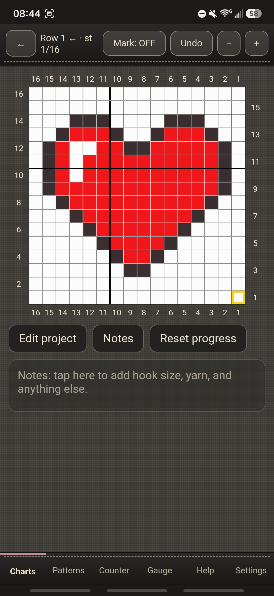
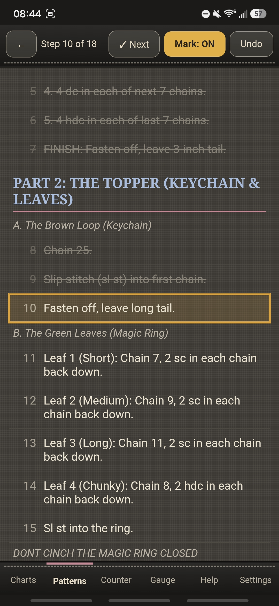
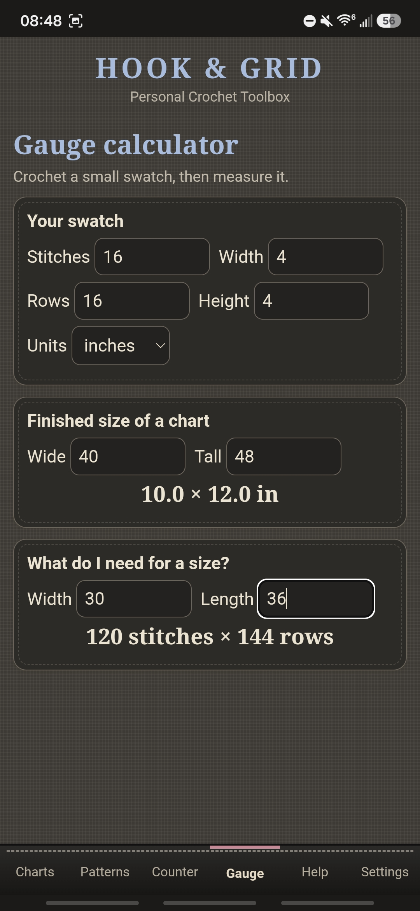
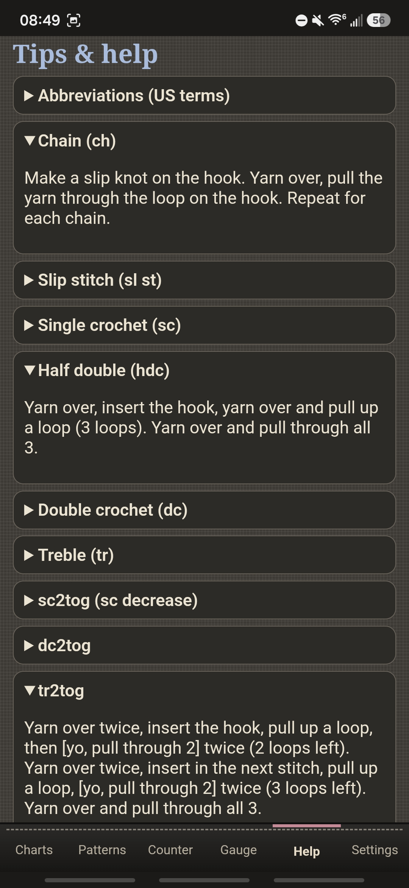

# 🧶 Hook & Grid

*A cozy little crochet toolbox for your phone.*

I made Hook & Grid for my own crochet projects: a calm place to keep track of where I am in a tapestry chart or a written pattern, without losing my spot every time I put the hook down. I'm sharing it in case it helps you too. 💛

## Peek inside

**[Watch a one minute tour](demo.mp4)** (no sound, just a quick look around)

## Try it

**https://escapereality94.github.io/hook-and-grid/**

- **Android:** open the link in Chrome, tap the ⋮ menu, then **Install app**. It lands on your home screen like any other app and works offline once it has loaded.
- **iPhone:** open the link in Safari, tap Share, then **Add to Home Screen**. I haven't been able to test this one myself, so I'd love to hear if it works for you.

## What's inside

- **Charts:** turn a picture into a stitch-by-stitch tapestry chart, up to 120 stitches wide and 150 rows tall, and choose your own yarn colors
- **Mark mode:** a little lock so a stray tap never moves your place, plus an Undo that steps back through your last moves
- **Zoom:** pinch in, or use the − and + buttons, and your top bar stays right where you need it
- **Notes:** a spot on every chart for hook size, yarn, and anything you want to remember
- **Patterns:** add a PDF, or type or paste one in, and check off each step as you go
- **Counter** for stitches and rows
- **Gauge calculator** to work out how many stitches and rows you need for a size
- **Tips & help** with stitch how-tos right in the app

## Good to know

- **Your projects stay on your phone.** Nothing is sent anywhere, and nobody else can see them.
- **Back them up.** Settings → Backup lets you copy everything, so you can move it to a new phone or keep a safe copy.
- Importing a PDF pattern needs an internet connection. Everything else works offline.
- Bigger charts get slow on a phone, which is why charts stop at 120 × 150.

If something doesn't work the way you'd expect, you're welcome to open an issue here and let me know.

## License

Hook & Grid is free for your own crafting, hobbies, and any other noncommercial use, under the [PolyForm Noncommercial License 1.0.0](LICENSE). Please don't sell it or use it for business. 🙏

Happy hooking! 🧶
